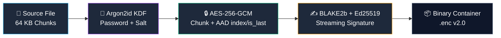

<div align="center">

🌐 **Language:** **English** | [Русский](README.md)

# 🔐 Secure File Encryptor (CLI)

**A command-line utility for streaming authenticated file encryption and digital signing using the Encrypt-then-Sign scheme**

</div>

---

## 🛡️ Cryptographic Stack

| Component | Algorithm / Standard | Purpose in the System |
| :--- | :--- | :--- |
| **Symmetric Encryption** | `AES-256-GCM` (AEAD) | Streaming confidentiality and authentication of chunks (64 KB) |
| **Key Derivation (KDF)** | `Argon2id` | Protection against password brute-forcing on GPU/ASIC (memory-hard) |
| **Digital Signature** | `Ed25519` + `BLAKE2b` | Streaming hashing and authenticity verification prior to decryption |
| **Metadata & Order Protection** | `AAD` (Binary Struct) | Binding the header, chunk index, and `is_last` flag to the GCM tag |
| **RAM Protection** | `bytearray` + `ctypes.memset` | Explicit zeroing of passwords and derived keys in RAM after execution |

---

## ⚙️ Security Architecture (Encrypt-then-Sign)



### Binary Container Structure (`v2.0`):
* **Header (45 bytes):** `MAGIC` (`AESS`) + `VERSION` (`2`) + Argon2id parameters (`time_cost`, `memory_cost`, `parallelism`) + `salt` (16 bytes) + `base_nonce` (12 bytes).
* **Payload (N chunks):** `[4-byte chunk length][chunk ciphertext (up to 64 KB) + 16-byte GCM tag]`. A unique nonce (`base_nonce ^ chunk_index`) is computed for each chunk.
* **Footer (64 bytes):** `Ed25519` digital signature over the `BLAKE2b` hash covering the entire header and all encrypted chunks.

### Core Security Principles:
1. **Fail-Fast Signature Verification:** During decryption, the utility **first** verifies the `Ed25519` digital signature across the entire stream. If the file is corrupted or tampered with, execution aborts before prompting for a password or running `Argon2id` (mitigating DoS attacks).
2. **Header and Chunk Order Authentication (AAD):** The header, chunk sequence number (`chunk_index`), and end-of-file flag (`is_last`) are passed into `AESGCM` as AAD. This prevents reordering, deletion, or truncation of chunks.
3. **Private Key Protection & Atomic Writes:** The `Ed25519` private key is stored in `PKCS#8` encrypted with a password (`BestAvailableEncryption`) and created atomically with `0o600` permissions. Output files are written via a temporary `.tmp` file using `os.fsync` and `os.replace`.
4. **RAM Scrubbing:** Sensitive data (passwords and encryption keys) are stored in mutable `bytearray` buffers and forcibly overwritten with zeros via `ctypes.memset` inside `finally` blocks.

---

## 🎯 Threat Model

### ✅ Mitigated Threats:
* **Ciphertext/Header Tampering & File Truncation:** Prevented by `Ed25519` (`BLAKE2b`) signature verification and `AES-GCM` authentication tags bound to `chunk_index` and `is_last`.
* **Offline Password Brute-Force:** Slowed down by `Argon2id` (64 MB RAM per iteration, 3 passes, 4 threads) combined with a random 128-bit `salt`.
* **Nonce Reuse:** A random 96-bit `base_nonce` is generated for each file, and a unique nonce is derived for every chunk via `base_nonce ^ chunk_index`.
* **DoS via KDF Parameters:** Strict validation of `Argon2id` parameters from the header prevents an attacker from forcing the program to allocate gigabytes of memory during decryption.
* **Out-of-Memory (OOM) on Large Files:** Streaming processing in 64 KB chunks allows encrypting files of any size with constant RAM usage.

### ⚠️ Limitations & Out-of-Scope Vectors:
* **Host Compromise (Malware / Keyloggers):** Does not protect against password interception or process memory dumping on an already compromised operating system.
* **Intermediate Python Objects:** Despite clearing `bytearray` buffers via `ctypes.memset`, individual intermediate copies inside C extensions or the Python interpreter cannot be guaranteed to be erased due to CPython's memory model.

---

## 🚀 Quick Start

```bash
# 1. Clone the repository and install dependencies
cd Secure-File-Encryptor
pip install -r requirements.txt

# 2. Generate an Ed25519 key pair
python AES.py keygen

# 3. Encrypt a file
python AES.py encrypt secret.txt secret.enc

# 4. Decrypt the file and verify the signature
python AES.py decrypt secret.enc decrypted.txt
```

---

## 🧪 Security Testing

The project includes over 30 unit and negative tests powered by `pytest`, verifying edge cases and real-world attack vectors (empty files, 1-byte and multi-chunk files, bit-flipping, signature corruption, key substitution, chunk truncation, and malicious Argon2id DoS parameters):

```text
tests/test_encryptor.py::test_memory_cleaner                         PASSED
tests/test_encryptor.py::test_derive_chunk_nonce                     PASSED
tests/test_encryptor.py::test_atomic_write_secret_permissions        PASSED
tests/test_encryptor.py::test_encrypt_file_two_chunks                PASSED
tests/test_encryptor.py::test_decrypt_file_invalid_signature         PASSED
tests/test_encryptor.py::test_decrypt_file_truncated_chunk           PASSED
tests/test_encryptor.py::test_decrypt_file_corrupted_chunk_with_valid_signature PASSED
tests/test_encryptor.py::test_decrypt_file_invalid_time_cost         PASSED
```

Run tests locally:
```bash
pytest -v
```

---

## 🗺️ Version History & Project Structure

* **[v1.0]:** JSON container with Base64 encoding, basic `Encrypt-then-Sign` scheme, negative security tests, and threat model.
* **[v2.0] (Current Release):** Streaming binary format (`AESS` v2, 64 KB chunks) for files of any size, `chunk_index` and `is_last` binding in AAD against chunk reordering/truncation, atomic file writes, and explicit key zeroing in RAM (`bytearray` + `ctypes.memset`).

---

## ⚠️ Disclaimer

This project was created for educational purposes and to demonstrate secure software development (AppSec) practices. The software is provided "as is", without warranty of any kind. Always keep backups of important files before encrypting them.

## Disclaimer
This project was created for educational and portfolio purposes. The software is provided "as is", without warranty of any kind. Always keep backups of important files before encrypting them.

