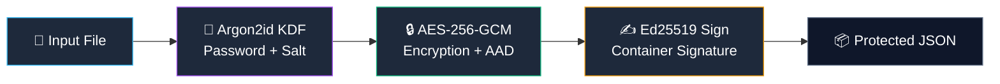

<div align="center">

🌐 **Language:** **English** | [Русский](README.ru.md)

# 🔐 Secure File Encryptor (CLI)

**A command-line utility for authenticated file encryption and digital signing using the Encrypt-then-Sign scheme**

[](https://python.org)
[](#cryptographic-stack)
[](#cryptographic-stack)
[](#cryptographic-stack)
[](https://github.com)

</div>

---

## 🛡️ Cryptographic Stack

| Component | Algorithm / Standard | Purpose in the System |
| :--- | :--- | :--- |
| **Symmetric Encryption** | `AES-256-GCM` (AEAD) | Data confidentiality and ciphertext authentication |
| **Key Derivation (KDF)** | `Argon2id` | Protection against GPU/ASIC brute-force attacks (memory-hard) |
| **Digital Signature** | `Ed25519` | Authenticity and integrity verification prior to decryption |
| **Metadata Protection** | `AAD` (Canonical JSON) | Cryptographic binding of container headers to the GCM tag |

---

## ⚙️ Security Architecture (Encrypt-then-Sign)



### Core Security Principles:
1. **Fail-Fast Signature Verification:** During decryption, the utility verifies the `Ed25519` signature **first**. If the container has been tampered with, execution aborts before running the resource-intensive `Argon2id` KDF (mitigating DoS vectors).
2. **Header Authentication (AAD):** Version, KDF parameters, `salt`, and `nonce` are serialized into canonical JSON and passed to `AESGCM` as Additional Authenticated Data. Any header modification invalidates decryption.
3. **Private Key Protection:** The `Ed25519` private key is stored in `PKCS#8` format encrypted with a passphrase (`BestAvailableEncryption`) and restricted file permissions (`0o600` on POSIX systems).

---

## 🎯 Threat Model

### ✅ Mitigated Threats:
* **Ciphertext & Metadata Tampering (Bit-flipping):** Prevented by `Ed25519` signature verification and the `AES-GCM` authentication tag (including AAD).
* **Offline Password Brute-Force:** Mitigated using memory-hard `Argon2id` (64 MB RAM per iteration, 3 passes, 4 threads) combined with a random 128-bit salt.
* **Nonce Reuse:** A cryptographically secure random 96-bit `nonce` is generated via `os.urandom` for every encryption operation.
* **KDF Parameter DoS:** Strict validation of `Argon2id` parameters in the header prevents attackers from forcing gigabytes of memory allocation during decryption.

### ⚠️ Limitations & Out-of-Scope Vectors:
* **Host Compromise (Malware / Keyloggers):** Does not protect against passphrase interception on an already compromised operating system.
* **Memory Dump Analysis (Core Dump):** Because `str` and `bytes` objects are immutable in Python, sensitive keys may persist in RAM until garbage collection *(planned fix via `bytearray` + `memset` zeroization in v2.0)*.
* **RAM Constraints (OOM):** In `v1.0`, files are loaded entirely into memory and Base64-encoded (+33% size overhead). Chunked streaming encryption is required for files >2 GB *(planned in v2.0)*.

---

## 🚀 Quick Start

```bash
# 1. Clone the repository and install dependencies
git clone https://github.com
cd Secure-File-Encryptor
pip install -r requirements.txt

# 2. Generate an Ed25519 key pair
python AES.py keygen

# 3. Encrypt a file
python AES.py encrypt -i secret.txt -o secret.enc.json

# 4. Decrypt and verify signature
python AES.py decrypt -i secret.enc.json -o decrypted.txt
```

---

## 🧪 Security Testing

The project includes negative security tests built with `pytest` to simulate real-world attack vectors:

```text
tests/test_encryptor.py::test_happy_path_and_empty_file         PASSED [ 16%]
tests/test_encryptor.py::test_bit_flip_in_ciphertext            PASSED [ 33%]
tests/test_encryptor.py::test_aad_header_tampering              PASSED [ 50%]
tests/test_encryptor.py::test_malformed_json_and_missing_fields PASSED [ 66%]
tests/test_encryptor.py::test_downgrade_and_dos_argon_params    PASSED [ 83%]
tests/test_encryptor.py::test_wrong_password_and_wrong_key      PASSED [100%]
```

Run tests locally:
```bash
pytest -v
```

---

## 🗺️ Roadmap & Project Structure

* **[v1.0.1] (Current Release):** JSON container, `Encrypt-then-Sign` scheme, negative security test suite, and threat model.
* **[v2.0.0] (Next Milestone):** Streaming binary format (64 KB chunks) for arbitrarily large files, anti-truncation AAD counters, and explicit RAM zeroization.
