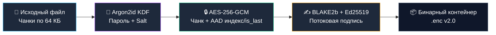

<div align="center">

🌐 **Язык:** [English](README.md) | **Русский**

# 🔐 Secure File Encryptor (CLI)

**Утилита командной строки для потокового аутентифицированного шифрования файлов и цифровой подписи по схеме Encrypt-then-Sign**

</div>

---

## 🛡️ Криптографический стек

| Компонент | Алгоритм / Стандарт | Назначение в системе |
| :--- | :--- | :--- |
| **Симметричное шифрование** | `AES-256-GCM` (AEAD) | Потоковая конфиденциальность и аутентификация чанков (64 КБ) |
| **Выработка ключа (KDF)** | `Argon2id` | Защита от перебора паролей на GPU/ASIC (требователен к памяти) |
| **Цифровая подпись** | `Ed25519` + `BLAKE2b` | Потоковое хеширование и проверка подлинности до расшифровки |
| **Защита метаданных и порядка** | `AAD` (Binary Struct) | Привязка заголовка, индекса чанка и флага `is_last` к тегу GCM |
| **Защита оперативной памяти** | `bytearray` + `ctypes.memset` | Явное зануление паролей и производных ключей в RAM после работы |

---

## ⚙️ Архитектура безопасности (Encrypt-then-Sign)



### Структура бинарного контейнера (`v2.0`):
* **Header (45 байт):** `MAGIC` (`AESS`) + `VERSION` (`2`) + параметры Argon2id (`time_cost`, `memory_cost`, `parallelism`) + `salt` (16 байт) + `base_nonce` (12 байт).
* **Payload (N чанков):** `[4 байта длина чанка][шифротекст чанка (до 64 КБ) + 16 байт GCM tag]`. Для каждого чанка вычисляется уникальный nonce (`base_nonce ^ chunk_index`).
* **Footer (64 байта):** цифровая подпись `Ed25519` от хеша `BLAKE2b`, охватывающего весь заголовок и все зашифрованные чанки.

### Ключевые принципы безопасности:
1. **Быстрая проверка подписи (Fail-Fast):** При расшифровке утилита **сначала** проверяет цифровую подпись `Ed25519` по всему потоку. Если файл повреждён или подменён, работа прерывается ещё до запроса пароля и запуска `Argon2id` (защита от DoS-атак).
2. **Аутентификация заголовков и порядка чанков (AAD):** Заголовок, порядковый номер чанка (`chunk_index`) и флаг конца файла (`is_last`) передаются в `AESGCM` как AAD. Это исключает перестановку, удаление или обрезание чанков.
3. **Защита приватного ключа и атомарность записи:** Приватный ключ `Ed25519` хранится в `PKCS#8` под паролем (`BestAvailableEncryption`) и создаётся атомарно с правами `0o600`. Выходные файлы записываются через временный `.tmp` с вызовом `os.fsync` и `os.replace`.
4. **Очистка RAM:** Чувствительные данные (пароли и ключи шифрования) хранятся в изменяемых буферах `bytearray` и принудительно затираются нулями через `ctypes.memset` в блоках `finally`.

---

## 🎯 Модель угроз

### ✅ Нейтрализуемые угрозы:
* **Подмена шифротекста, заголовков и обрезание файла:** Предотвращается проверкой подписи `Ed25519` (`BLAKE2b`) и тегами аутентификации `AES-GCM` с привязкой к `chunk_index` и `is_last`.
* **Офлайн-перебор пароля (Brute-Force):** Замедляется использованием `Argon2id` (64 МБ RAM на итерацию, 3 прохода, 4 потока) в сочетании со случайной 128-битной солью (`salt`).
* **Повторное использование Nonce:** Для каждого файла генерируется случайный 96-битный `base_nonce`, а для каждого чанка выводится уникальный nonce через `base_nonce ^ chunk_index`.
* **DoS через параметры KDF:** Строгая валидация параметров `Argon2id` из заголовка не позволяет злоумышленнику заставить программу выделить гигабайты памяти при расшифровке.
* **Исчерпание памяти на больших файлах (OOM):** Потоковая обработка чанками по 64 КБ позволяет шифровать файлы любого размера с константным расходом RAM.

### ⚠️ Ограничения и векторы вне зоны покрытия:
* **Компрометация хоста (вредоносное ПО / кейлоггеры):** Не защищает от перехвата пароля или чтения памяти процесса на уже заражённой операционной системе.
* **Промежуточные объекты Python:** Несмотря на очистку буферов `bytearray` через `ctypes.memset`, отдельные промежуточные копии внутри C-расширений или интерпретатора Python не могут быть гарантированно удалены из-за особенностей модели памяти CPython.

---

## 🚀 Быстрый старт

```bash
# 1. Клонируйте репозиторий и установите зависимости
cd Secure-File-Encryptor
pip install -r requirements.txt

# 2. Сгенерируйте пару ключей Ed25519
python AES.py keygen

# 3. Зашифруйте файл
python AES.py encrypt secret.txt secret.enc

# 4. Расшифруйте файл и проверьте подпись
python AES.py decrypt secret.enc decrypted.txt
```

---

## 🧪 Тестирование безопасности

Проект включает более 30 модульных и негативных тестов на базе `pytest`, проверяющих граничные случаи и реальные векторы атак (пустые файлы, файлы в 1 байт и несколько чанков, подмена битов, повреждение подписи, подмена ключа, обрезание чанков, DoS-параметры Argon2id):

```text
tests/test_encryptor.py::test_memory_cleaner                         PASSED
tests/test_encryptor.py::test_derive_chunk_nonce                     PASSED
tests/test_encryptor.py::test_atomic_write_secret_permissions        PASSED
tests/test_encryptor.py::test_encrypt_file_two_chunks                PASSED
tests/test_encryptor.py::test_decrypt_file_invalid_signature         PASSED
tests/test_encryptor.py::test_decrypt_file_truncated_chunk           PASSED
tests/test_encryptor.py::test_decrypt_file_corrupted_chunk_with_valid_signature PASSED
tests/test_encryptor.py::test_decrypt_file_invalid_time_cost         PASSED
```

Локальный запуск тестов:
```bash
pytest -v
```

---

## 🗺️ История версий и структура проекта

* **[v1.0]:** JSON-контейнер с Base64, базовая схема `Encrypt-then-Sign`, негативные тесты безопасности и модель угроз.
* **[v2.0] (Текущий релиз):** Потоковый бинарный формат (`AESS` v2, чанки по 64 КБ) для файлов любого размера, привязка `chunk_index` и `is_last` в AAD от перестановки/обрезания чанков, атомарная запись файлов и явное зануление ключей в RAM (`bytearray` + `ctypes.memset`).

---

## ⚠️ Дисклеймер

Проект создан в образовательных целях и для демонстрации практик безопасной разработки (AppSec). Программное обеспечение предоставляется «как есть», без каких-либо гарантий. Всегда сохраняйте резервные копии важных файлов перед шифрованием.

