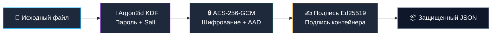

<div align="center">

🌐 **Язык:** [English](README.md) | **Русский**

# 🔐 Secure File Encryptor (CLI)

**Утилита командной строки для аутентифицированного шифрования файлов и цифровой подписи по схеме Encrypt-then-Sign**

[](https://python.org)
[](#криптографический-стек)
[](#криптографический-стек)
[](#криптографический-стек)
[](https://github.com)

</div>

---

## 🛡️ Криптографический стек

| Компонент | Алгоритм / Стандарт | Назначение в системе |
| :--- | :--- | :--- |
| **Симметричное шифрование** | `AES-256-GCM` (AEAD) | Конфиденциальность данных и аутентификация шифротекста |
| **Выработка ключа (KDF)** | `Argon2id` | Защита от перебора паролей на GPU/ASIC (требователен к памяти) |
| **Цифровая подпись** | `Ed25519` | Проверка подлинности и целостности контейнера до расшифровки |
| **Защита метаданных** | `AAD` (Канонический JSON) | Криптографическая привязка заголовков контейнера к тегу GCM |

---

## ⚙️ Архитектура безопасности (Encrypt-then-Sign)



### Ключевые принципы безопасности:
1. **Быстрая проверка подписи (Fail-Fast):** При расшифровке утилита **сначала** проверяет цифровую подпись `Ed25519`. Если контейнер был изменен, работа прерывается еще до запуска ресурсоемкого `Argon2id` (защита от DoS-атак).
2. **Аутентификация заголовков (AAD):** Версия, параметры KDF, `salt` и `nonce` сериализуются в канонический JSON и передаются в `AESGCM` как дополнительные аутентифицируемые данные (AAD). Любая подмена заголовка делает расшифровку невозможной.
3. **Защита приватного ключа:** Приватный ключ `Ed25519` хранится в формате `PKCS#8`, зашифрован паролем (`BestAvailableEncryption`) и имеет строгие права доступа (`0o600` в POSIX-системах).

---

## 🎯 Модель угроз

### ✅ Нейтрализуемые угрозы:
* **Подмена шифротекста и метаданных (Bit-flipping):** Предотвращается проверкой подписи `Ed25519` и тегом аутентификации `AES-GCM` (включая AAD).
* **Офлайн-перебор пароля (Brute-Force):** Замедляется использованием `Argon2id` (64 МБ RAM на итерацию, 3 прохода, 4 потока) в сочетании со случайной 128-битной солью (`salt`).
* **Повторное использование Nonce:** Для каждой операции шифрования через `os.urandom` генерируется криптографически стойкий случайный 96-битный `nonce`.
* **DoS через параметры KDF:** Строгая валидация параметров `Argon2id` в заголовке не позволяет злоумышленнику заставить программу выделить гигабайты памяти при расшифровке.

### ⚠️ Ограничения и векторы вне зоны покрытия:
* **Компрометация хоста (вредоносное ПО / кейлоггеры):** Не защищает от перехвата пароля на уже зараженной операционной системе.
* **Анализ дампов памяти (Core Dump):** Поскольку объекты `str` и `bytes` в Python неизменяемы, ключи могут оставаться в оперативной памяти до сборки мусора *(запланировано исправление через `bytearray` + зануление памяти в v2.0)*.
* **Ограничения RAM (OOM):** В `v1.0` файлы загружаются в память целиком и кодируются в Base64 (+33% к размеру). Для файлов >2 ГБ требуется потоковое шифрование чанками *(запланировано в v2.0)*.

---

## 🚀 Быстрый старт

```bash
# 1. Клонируйте репозиторий и установите зависимости
git clone https://github.com
cd Secure-File-Encryptor
pip install -r requirements.txt

# 2. Сгенерируйте пару ключей Ed25519
python AES.py keygen

# 3. Зашифруйте файл
python AES.py encrypt -i secret.txt -o secret.enc.json

# 4. Расшифруйте файл и проверьте подпись
python AES.py decrypt -i secret.enc.json -o decrypted.txt
```

---

## 🧪 Тестирование безопасности

Проект включает набор негативных тестов на базе `pytest`, имитирующих реальные векторы атак:

```text
tests/test_encryptor.py::test_happy_path_and_empty_file         PASSED [ 16%]
tests/test_encryptor.py::test_bit_flip_in_ciphertext            PASSED [ 33%]
tests/test_encryptor.py::test_aad_header_tampering              PASSED [ 50%]
tests/test_encryptor.py::test_malformed_json_and_missing_fields PASSED [ 66%]
tests/test_encryptor.py::test_downgrade_and_dos_argon_params    PASSED [ 83%]
tests/test_encryptor.py::test_wrong_password_and_wrong_key      PASSED [100%]
```

Локальный запуск тестов:
```bash
pytest -v
```

---

## 🗺️ План развития и структура проекта

* **[v1.0.1] (Текущий релиз):** JSON-контейнер, схема `Encrypt-then-Sign`, набор негативных тестов безопасности и модель угроз.
* **[v2.0.0] (Следующий этап):** Потоковый бинарный формат (чанки по 64 КБ) для файлов любого размера, счетчики чанков в AAD от обрезания файла и явная очистка ключей в RAM.
